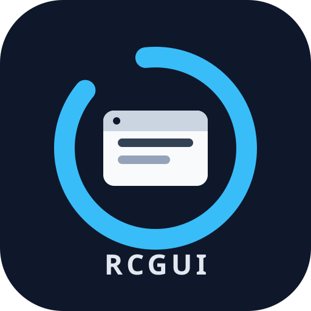
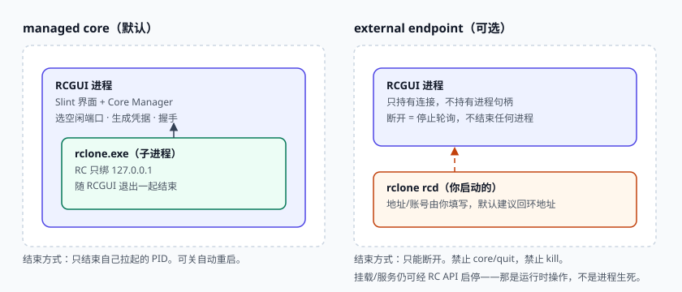
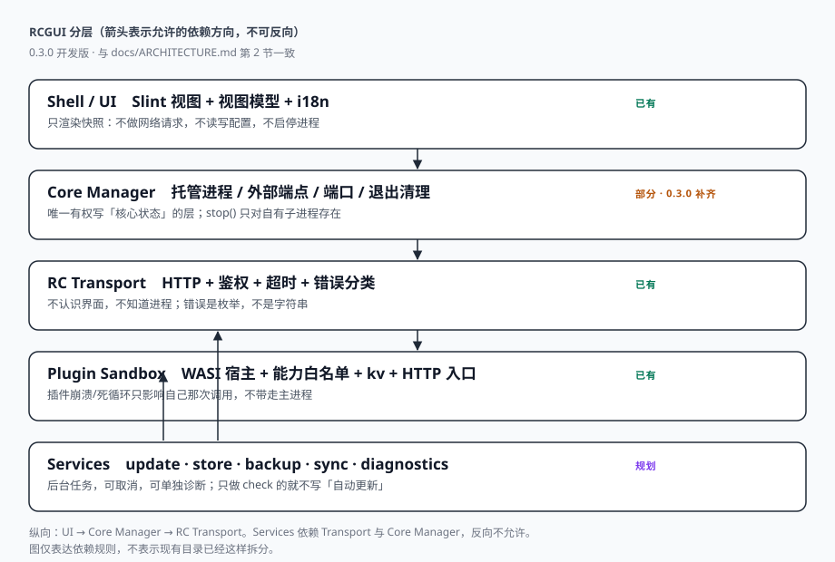
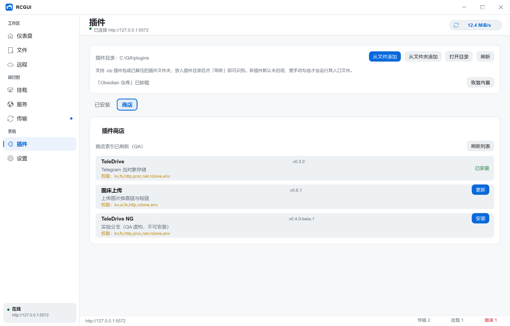

# RCGUI



[English](README.md) | [简体中文](README.zh-CN.md)

A Windows desktop front end for [rclone](https://rclone.org/), written in Rust with a [Slint](https://slint.dev) interface. There is no webview: the window is native, drawn by Slint, and talks to rclone over rclone's own RC API.

**Status: version 0.3.0 is in development.** The newest released build is **v0.2.1**. Everything this page marks *developing* is in the tree at HEAD and has not shipped; nothing here is called released until a tag, a GitHub Release and the assets listed below actually exist together. The version history and the exact wording rules are in [`docs/VERSIONING.md`](docs/VERSIONING.md) and [`docs/CHANGELOG.md`](docs/CHANGELOG.md).

## What changed in 0.3.0

Until 0.2.1 RCGUI was strictly a client: you started `rclone rcd` yourself (or let the *one-click rclone* plugin do it) and pointed the app at that endpoint.

0.3.0 (developing) makes RCGUI own a local rclone process by default, while keeping the old way as a first-class option:



| Mode | Who starts rclone | Who may stop it | When to use it |
| --- | --- | --- | --- |
| **Managed core** (default in 0.3.0) | RCGUI starts a bundled `rclone.exe` on a loopback port with a generated password | RCGUI, and only the process it started itself | You want to click the icon and use the app |
| **External endpoint** | You, by hand or by a service manager | You. RCGUI only disconnects | You already run `rclone rcd` for other tools and want one source of truth |

The rules that make this safe are written down in [`AGENTS.md`](AGENTS.md) and [`docs/ARCHITECTURE.md`](docs/ARCHITECTURE.md); the short version:

- RCGUI stops **only** the process it started, identified by PID plus a job object. It never calls `core/quit`, never kills a process it did not start, and never scans for stray `rclone.exe` on the machine.
- If startup fails, it says why and stays stopped. It does not retry in the background forever, and it does not silently fall back to a different port.
- Credentials for a managed core are generated per launch, kept in memory, and never written to logs.

## Architecture



Five layers, and only the first one touches the screen:

| Layer | Responsibility |
| --- | --- |
| **Shell / UI** | Slint views, keyboard navigation, the declarative settings panels plugins describe. Runs everything user-facing on the UI thread; long work hands off to async tasks. |
| **Core manager** (developing) | Chooses managed core or external endpoint, starts and supervises the child process, reports health, performs the one orderly shutdown. |
| **RC transport** | Typed client for rclone's RC API: handshake, timeouts, error mapping, the projection of remote state the UI renders. |
| **Plugin sandbox** | WASI host for `wasm32-wasip1` modules, capability broker, per-plugin storage, HTTP entry dispatch. |
| **Services** (partly developing) | Update check, plugin store, backup, sync and diagnostics live here as separate concerns, so none of them can block the UI. |

The layers are not one crate each. The core manager is `crates/app/src/core.rs` — executable discovery, start, health, one orderly shutdown — and it exists at HEAD but has not shipped. `crates/rclone` is still an attach-only helper, and its test `crate_has_no_process_spawning` keeps asserting that it starts nothing; that test is not going away. The services layer is a set of modules in `crates/app/src/` (`maintenance.rs`, `store.rs`, `update.rs`, `backup.rs`, `sync_tasks.rs`, `cli.rs`), not a crate of its own. `docs/ARCHITECTURE.md` labels every piece as existing, partial or planned.

## Features

Status legend: **released** = present in v0.2.1; **developing** = in the tree at HEAD, unreleased.

| Page | What you can do | Status |
| --- | --- | --- |
| **Dashboard** | Connection state and the endpoint actually in use, live counters for remotes / mounts / services / transfers, and a history of what the app just did | released |
| **Files** | Two-pane browser — local disk left, remote right — sort menu, multi-select, upload and download into a chosen folder, drag and drop between panes | released |
| **Remotes** | Create, edit, delete remotes; a dedicated **K-Vault** form (a WebDAV-derived rclone backend plus the site's own upload API, so links and de-duplication come from the site, not from DAV); a list of proxies bound per remote and re-applied on start | released |
| **Mounts** | Mount to a drive letter with cache mode and read-only flags, see whether the letter appeared, install WinFsp from the official or a mirror source, re-create remembered mounts after the next connect | released |
| **Services** | Serve a remote over HTTP, WebDAV, FTP, SFTP or DLNA with per-service credentials; start, stop, inspect, and re-create remembered services on reconnect | released |
| **Transfers** | Live and finished transfers with progress, speed and totals, background jobs labelled by kind | released |
| **Plugins** | Install, enable, disable, uninstall; declarative settings panel; restore a built-in plugin you removed; open the plugin directory | released |
| **Settings** | RC endpoint and credentials, theme, accent colour, language, winget mirror, config path, `rcgui.conf` import/export, core selection | endpoint and appearance released; **core selection developing** |
| **Plugin store** | Browse the static index, look up permissions and source, install a verified release archive | developing (index, page and the in-app client are all in the tree; unpublished) |
| **Diagnostics** | `--diagnostics --json`, a support bundle, an accessibility tree dump for scripting and review | developing (the CLI is in the tree at HEAD; the contract is [`docs/CLI.md`](docs/CLI.md)) |

Not planned, so it does not surprise anyone later: a webview UI, taking over a process RCGUI did not start, and adding native backends to an official rclone build by editing metadata.

## Install

Two artifacts per release, one naming scheme:

```
RCGUI-<version>-windows-x64-setup.exe      # installer
RCGUI-<version>-windows-x64-portable.zip   # portable
```

- **Setup** installs per user by default — under `%LOCALAPPDATA%\Programs\RCGUI` — and asks for elevation only if you choose a location that needs it. Your data lives in `%APPDATA%\RCGUI` and is never overwritten by an upgrade: an uninstall leaves it in place.
- **Portable**: unzip anywhere and run the exe next to an empty file named `portable`. The archive contains `rclone-gui.exe`, the pinned `core\rclone.exe`, the plugins that ship with the app, and a `licenses\` folder. Data then goes to `data\` beside the exe.
- Both ship the **enhanced** rclone core by default: [gulp79/rclone-extra](https://github.com/gulp79/rclone-extra) at `v1.76.0-extra`, a fork of rclone v1.76.0 that adds backends upstream does not have (alist, alldebrid, teldrive, terabox). `core\.fetched.json` inside the package records which source was used and its SHA-256. Builds from plain upstream rclone are still possible and are named with an `-upstream` suffix, so the two can never be confused.
- Both carry `SHA256SUMS` and the third-party license files (`licenses\`), including rclone's MIT `COPYING`. Download the checksums from the same Release page and compare before running.

**The 0.3.0 assets do not exist yet** — these filenames are the contract the release workflow implements, not links. The only published release is [v0.2.1](https://github.com/h897105167/rclone_gui_windows/releases/tag/v0.2.1), whose asset predates the scheme and is named `rclone-gui-v0.2.1-windows-amd64.zip`.

### Build from source

```powershell
git clone https://github.com/h897105167/rclone_gui_windows.git
cd rclone_gui_windows
.\scripts\build.ps1 -Release
```

`build.ps1` does three things in order: fetches the pinned plugin archives into `crates\app\assets\plugins\`, verifies each SHA-256 against `plugins/manifest.json`, then fetches the pinned rclone release into `target\release\core\` (that is the "core" — the `rclone.exe` the app manages itself), and finally builds the workspace. It prints the path of `target\release\rclone-gui.exe`. `-SkipPlugins` builds without touching the plugin cache, `-SkipCore` leaves `core\rclone.exe` out (the app then only has external endpoints to talk to), `-CoreZip <path>` uses a local rclone archive instead of downloading, `-CoreSource upstream` fetches plain upstream rclone instead of the default enhanced fork, and `-Run` launches the result.

Packaging (`.\scripts\build-release.ps1`) refuses to run if the core or its `COPYING` is missing, so a release can never ship rclone without its license.

Requirements: Windows 10/11 x64, Rust with the MSVC toolchain, and `rustup target add wasm32-wasip1` for the plugins. WinFsp is optional and only needed for the Mounts page.

## Performance

No performance numbers are published for 0.3.0, because no 0.3.0 build has been measured. The measurement tool is in the repository and anyone can run it:

```powershell
.\scripts\measure-perf.ps1 -Exe .\target\release\rclone-gui.exe -Samples 5 -Json
```

It launches one process per sample with its own data directory, waits for the real readiness signal, reads working set, private bytes and peak, then ends only the process tree it started. A sample whose own data directory never appeared is dropped instead of being recorded, so an instance already running on your desktop cannot quietly flatter the result. It reports `null` when it cannot read a value and exits `2` rather than printing a zero. What each column means, the median convention, the known blind spots (Win32 alias executables cannot be measured; tray-only builds need `-HealthUrl`) and the rules for quoting a number are in [`docs/PERFORMANCE.md`](docs/PERFORMANCE.md).

## Privacy and plugin permissions

- No telemetry, no analytics, no network calls you did not configure. The update check and the plugin store are the only outbound requests the app makes on your behalf, and both are documented in [`docs/RELEASE.md`](docs/RELEASE.md).
- External-endpoint RC passwords are stored in cleartext in `config.json`. Managed-core RC credentials are generated per launch and excluded from saved configuration and exports. Keep RC on loopback. `rclone obscure` is obfuscation, not encryption.
- Plugins are `wasm32-wasip1` modules inside a WASI sandbox. They reach the system only through capabilities they declare in `config.json`: `kv`, `ui`, `fs`, `http`, `proc`, `net`, `rclone`, `env`. `fs.`, `proc.` and `http.` are the ones worth reading before you trust a plugin; the store page shows them next to every entry.
- The embedded HTTP server (default port 5273) binds to loopback and has no authentication of its own. The port is no longer editable in Settings — the app still writes it to `config.json`, so change it there if you need to. Treat anything a plugin exposes through `http_entry` as reachable by any local process.

## Plugins and the store

Plugins live in their own repositories; this repository keeps only the lock file `plugins/manifest.json`, which pins a tag, an asset name and a SHA-256 per plugin, and it builds the ones that ship with the app.

| Plugin | Version | What it does |
| --- | --- | --- |
| [imagehost](https://github.com/h897105167/rcgui-plugin-imagehost) | 0.6.1 | Uploads local images to an rclone remote, hands back a direct link (optionally shortened), and serves an HTTP upload endpoint |
| [teldrive](https://github.com/h897105167/rcgui-plugin-teldrive) | 0.3.0 | Deploys teldrive, signs in to Telegram, creates channels and a bot, then adds the remote to rclone and mounts it. Needs the teldrive build of rclone — official rclone has no teldrive backend |

Those two are what the portable archive carries. The [oneclick](https://github.com/h897105167/rcgui-plugin-oneclick) plugin is not among them, and not in the store either: it starts and supervises its own rclone, which is now the managed core's job, and its newer builds no longer start rclone themselves. Installing it by hand therefore does not restore the old behaviour — use the managed core, or keep your own `rclone rcd` and connect in external-endpoint mode.

The intended deployment addresses are below. The new store goes live after this change is merged and its Pages workflow is enabled:

- Web page: <https://h897105167.github.io/rclone_gui_windows/store/>
- Index the app reads: <https://h897105167.github.io/rclone_gui_windows/store/index.json>

Every entry is a URL plus a SHA-256 that the app verifies before unpacking, so the index can list a plugin whose code lives in someone else's repository — including yours.

Authors submit a manifest through a pull request to [`docs/store/index.json`](docs/store/index.json); the submission rules, the review gate and the checks the CI runs are in [`docs/store/README.md`](docs/store/README.md). Nothing in the store is executable code hosted by the repository — entries are URLs plus a SHA-256, and the app verifies the hash before unpacking.

In 0.3.0, the new-remote list comes from the connected rclone core and presets declared by enabled plugins. The [kvault plugin](https://github.com/h897105167/rcgui-plugin-kvault) supplies the K-Vault connection wizard and WebDAV preset; the app no longer inserts that type unconditionally. The app retains the site's file-upload adapter and compatibility with existing remotes. The plugin source and test archive are under review, **unreleased and absent from the store**. Store entries require a real Release asset and verified checksum.



*A preview of the 0.3.0 development build: the Plugins window, Store tab. The rows are QA fixture data — one entry is deliberately fictional — so the picture shows the layout, not the published store contents.*

## Upgrading from 0.2.x

- Your data directory stays `%APPDATA%\RCGUI`; a first run also copies an existing `%APPDATA%\rclone-gui\` over, so older installs keep their settings.
- If you used the one-click plugin, its `bin\rclone.exe` is still on disk and still usable. 0.3.0 starts a managed core by default; point the app at that binary as a custom core if you would rather keep using it, or keep running your own `rclone rcd` and connect in **external endpoint** mode. What no longer works is letting the plugin start rclone for you: the newer plugin builds do not.
- **teldrive** remotes need care: the plugin deploys a `bin\rclone.exe` built from the tgdrive/rclone fork, because official rclone has no teldrive provider. If the core currently selected in Settings has no `teldrive` backend, choose that deployed `bin\rclone.exe` as the core. Editing a remote's metadata cannot add a native backend to an official rclone build.

## Documentation

| File | Contents |
| --- | --- |
| [`docs/ARCHITECTURE.md`](docs/ARCHITECTURE.md) | Layers, core modes, concurrency, caching, credentials, accessibility, and what is planned rather than built |
| [`docs/PLUGIN.md`](docs/PLUGIN.md) | Plugin manifest, capabilities, action protocol, HTTP entry points |
| [`docs/store/README.md`](docs/store/README.md) | Store index schema, submission and review process |
| [`docs/CLI.md`](docs/CLI.md) | Command-line contract for 0.3.0 — in the tree, not yet released: `--version`, `--diagnostics --json`, `--validate-config <path>`, `--list-plugins`, `--export-accessibility-tree <path>` |
| [`docs/RELEASE.md`](docs/RELEASE.md) | Artifact names, checksums, the pinned core manifest, and what a release must contain |
| [`docs/PERFORMANCE.md`](docs/PERFORMANCE.md) | What is measured, how, and how to quote a number honestly |
| [`docs/ACCEPTANCE.md`](docs/ACCEPTANCE.md) | 0.3.0 requirement mapping, acceptance evidence and remaining release checks |
| [`docs/VERSIONING.md`](docs/VERSIONING.md) | Version rules, tag policy, changelog rules |
| [`docs/CHANGELOG.md`](docs/CHANGELOG.md) | Everything that changed, newest first |
| [`CONTRIBUTING.md`](CONTRIBUTING.md) | Build, review gates, what gets rejected |
| [`docs/proxy-verification.md`](docs/proxy-verification.md) | What each rclone backend actually accepts for a proxy, measured |

## Project layout

```
crates/
  app/       Slint views, RC wiring, embedded HTTP server, managed core
             (core.rs), services (maintenance, store, update, backup,
             sync, cli), K-Vault file adapter and legacy compatibility
  i18n/      Chinese/English dictionaries and the t / f helpers
  profile/   the versioned rcgui.conf import/export format
  rc/        typed client for rclone's RC API
  rclone/    process helpers: attach and exe discovery only; its guard
             test asserts that it starts nothing
  plugin/    WASI plugin host, capability broker, manifest handling
plugins/
  manifest.json   pinned plugin tags, asset names and SHA-256
packaging/        core manifest and the Inno Setup script
scripts/          build, plugin fetch, core fetch, packaging, performance
docs/             architecture, plugin, store, release, versioning, assets
```

## Security

- Only RCGUI's own child process is ever stopped; in external-endpoint mode the app can do nothing but disconnect.
- Plugin archives are verified twice: at fetch time against the lock file and the store index, and again when unpacked into `%APPDATA%\RCGUI\plugins\<id>\`. A hash mismatch is a hard failure, never a warning.
- Builds and release assets contain no credentials, no tokens and no absolute developer paths; `.gitignore` and the packaging script both refuse to include local data.

## License

This repository does not declare a project license yet, so there is no legal grant to reuse it beyond what GitHub's terms and applicable law allow. Third-party components keep their own licenses, collected under `licenses/` in release artifacts — rclone, for instance, is MIT.
