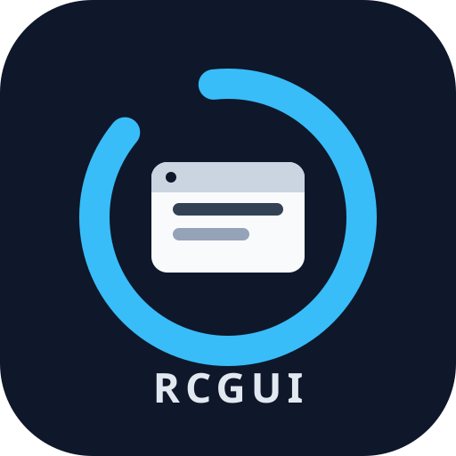
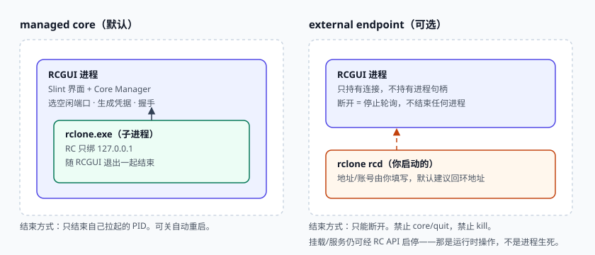
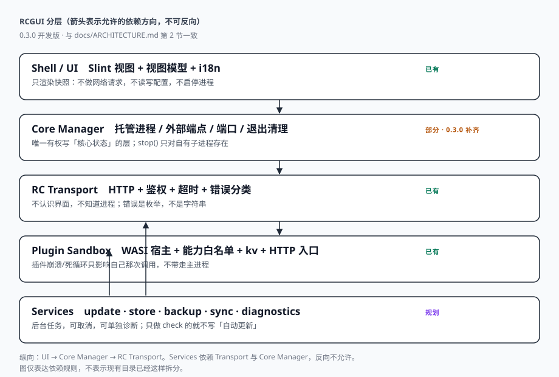
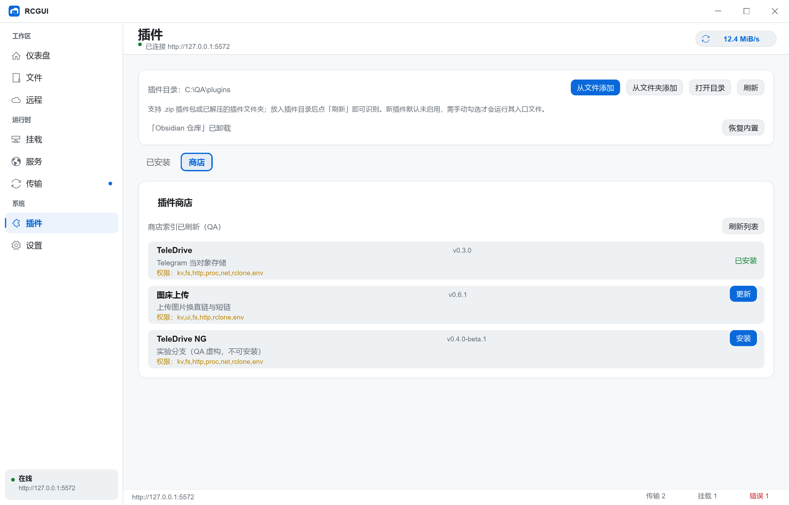

# RCGUI



[English](README.md) | 简体中文

rclone 的 Windows 桌面前端，用 Rust 写，界面用 [Slint](https://slint.dev)。没有 webview：窗口是原生的，由 Slint 直接绘制，通过 rclone 自己的 RC API 与它通信。

**当前状态：0.3.2 正在开发中。** 对外发布的版本仍是 **v0.2.1**。本文里标“开发中”的东西都只存在于 HEAD，尚未发布；只有 tag、GitHub Release 和下面列出的那些产物同时存在，才算发布。版本规则与措辞规范见 [`docs/VERSIONING.md`](docs/VERSIONING.md) 和 [`docs/CHANGELOG.md`](docs/CHANGELOG.md)。`v0.3.0` 和 `v0.3.1` 都没有过 tag：下文说的「0.3.0」就是这一批工作，它随 0.3.2 一起发布。

## 0.3.0 改了什么

到 0.2.1 为止，RCGUI 只是一个客户端：你自己起 `rclone rcd`（或者用「一键 rclone」插件起），把地址填进应用。

0.3.0（开发中）默认由 RCGUI 自己管理一个本地 rclone 进程，同时把老办法保留为一等公民：



| 模式 | 谁启动 rclone | 谁可以停它 | 什么时候用 |
| --- | --- | --- | --- |
| **受管内核**（0.3.0 默认） | RCGUI 用一个随机密码在回环地址上启动自带的 `rclone.exe` | RCGUI，而且只能停它自己启动的那个进程 | 想让图标点开即可用 |
| **外部端点** | 你自己，手工或交给服务管理器 | 你自己。RCGUI 只会断开连接 | 机器上已经有 `rclone rcd` 给别的工具用，需要单一事实来源 |

让这件事安全的规则写在 [`AGENTS.md`](AGENTS.md) 和 [`docs/ARCHITECTURE.md`](docs/ARCHITECTURE.md) 里，简版是三条：

- RCGUI 只停**自己启动**的那个进程，认的是 PID 加 job object。它不调用 `core/quit`，不杀不是自己拉起的进程，也不会去机器上扫描多余的 `rclone.exe`。
- 启动失败就说明原因并保持停止，不会在后台无限重试，也不会偷偷换端口。
- 受管内核心的凭据每次启动现生成，只留在内存里，不写进日志。

## 架构



五层，只有第一层碰屏幕：

| 层 | 职责 |
| --- | --- |
| **外壳 / 界面** | Slint 视图、键盘导航、渲染插件声明的设置面板。所有面向用户的操作都在 UI 线程，长任务交给异步一侧。 |
| **内核管理**（开发中） | 选择受管内核还是外部端点，启动并监督子进程，报告健康状态，执行唯一一次有序关闭。 |
| **RC 传输** | rclone RC API 的类型化客户端：握手、超时、错误映射，以及界面渲染的那份状态投影。 |
| **插件沙箱** | `wasm32-wasip1` 模块的 WASI 宿主、能力代理、每插件独立存储、HTTP 入口分发。 |
| **服务**（部分开发中） | 更新检查、插件商店、备份、同步、诊断各归各的，互不阻塞界面。 |

分层不等于一个 crate 一层。内核管理在 `crates/app/src/core.rs`——发现可执行文件、启动、健康检查、一次有序关闭——HEAD 里已经有实现，但还没发布过。`crates/rclone` 仍然只是一个 attach 辅助层，它的 `crate_has_no_process_spawning` 测试继续断言自己不创建进程；那个测试不会消失。服务层是 `crates/app/src/` 里的一组模块（`maintenance.rs`、`store.rs`、`update.rs`、`backup.rs`、`sync_tasks.rs`、`cli.rs`），不是独立的 crate。`docs/ARCHITECTURE.md` 逐条标了「已有 / 部分 / 规划」。

## 功能

状态说明：**已发布** = v0.2.1 里就有；**开发中** = HEAD 里有、还没发布。

| 页面 | 能做什么 | 状态 |
| --- | --- | --- |
| **仪表盘** | 连接状态与真正在用的端点，远程 / 挂载 / 服务 / 传输的实时计数，以及刚刚发生过什么的历史 | 已发布 |
| **文件** | 双栏浏览——左边本地磁盘、右边远程——排序菜单、多选、上传与下载到指定目录、两栏之间拖放 | 已发布 |
| **远程** | 新建 / 编辑 / 删除远程；K-Vault 有专门的表单（它是 WebDAV 派生出来的后端，直链与去重走站点自己的上传 API，不是纯 DAV）；按远程绑定代理列表，启动时重新应用 | 已发布 |
| **挂载** | 用缓存模式与只读标志挂到盘符，确认盘符真的出现了，从官方或镜像源装 WinFsp，重连后重建记住的挂载 | 已发布 |
| **服务** | 把远程以 HTTP / WebDAV / FTP / SFTP / DLNA 提供出去，带各自的凭据；启动、停止、查看，重连后重建 | 已发布 |
| **传输** | 进行中与已完成的传输，进度、速度、总量，后台任务按种类标注 | 已发布 |
| **插件** | 安装、启用、停用、卸载；渲染声明式设置面板；恢复被删掉的内置插件；打开插件目录 | 已发布 |
| **设置** | RC 端点与凭据、主题、强调色、语言、winget 镜像、配置文件路径、`rcgui.conf` 导入导出、内核选择 | 端点与外观已发布；**内核选择开发中** |
| **插件商店** | 浏览静态索引，查看权限与来源，安装校验过 hash 的发布包 | 开发中（索引、页面和应用里的商店客户端都在树里，尚未发布） |
| **诊断** | `--diagnostics --json`、支持包、供脚本与审查用的可访问性树导出 | 开发中（CLI 已在 HEAD 的树里；规范见 [`docs/CLI.md`](docs/CLI.md)） |

明确不做，免得以后意外：webview 界面；接管不是自己启动的进程；靠改元数据给官方 rclone 加原生后端。

## 安装

每个发布两个产物，一套命名：

```
RCGUI-<version>-windows-x64-setup.exe      # 安装包
RCGUI-<version>-windows-x64-portable.zip   # 便携版
```

- **安装包**默认按用户安装，装到 `%LOCALAPPDATA%\Programs\RCGUI`，只有当你选了一个需要管理员权限的目录时才会请求提权。数据在 `%APPDATA%\RCGUI`，升级从不覆盖它；卸载也会把它留下。
- **便携版**：解压到任意目录，在与 exe 同级放一个名为 `portable` 的空文件，然后运行。压缩包里是 `rclone-gui.exe`、固定版本的 `core\rclone.exe`、随应用发布的插件，以及 `licenses\`。此时数据写到 exe 旁边的 `data\`。
- 两者都带 `SHA256SUMS` 与第三方许可证（`licenses\`，含 rclone 的 MIT `COPYING`）。请从同一个 Release 页面下载校验文件，运行前先比对。
- 两者默认带的是**增强版** rclone 内核：[gulp79/rclone-extra](https://github.com/gulp79/rclone-extra) 的 `v1.76.0-extra`，它是 rclone v1.76.0 的分支，补了原版没有的后端（alist、alldebrid、teldrive、terabox）。包里的 `core\.fetched.json` 记着这次用的是哪个来源、哈希是多少。用原版 rclone 构建依然可以，产物名带 `-upstream` 后缀，两者不会混。

**0.3.0 的产物现在还不存在**——上面是发布流程要实现的契约，不是链接。唯一已发布的版本是 [v0.2.1](https://github.com/h897105167/rclone_gui_windows/releases/tag/v0.2.1)，那个产物的命名早于本方案，叫 `rclone-gui-v0.2.1-windows-amd64.zip`。

### 从源码构建

```powershell
git clone https://github.com/h897105167/rclone_gui_windows.git
cd rclone_gui_windows
.\scripts\build.ps1 -Release
```

`build.ps1` 依次做三件事：按 `plugins/manifest.json` 把插件包拉进 `crates\app\assets\plugins\` 并逐个核对 SHA-256；按 `packaging/core-manifest.json` 把固定版本的 rclone 取到 `target\release\core\`（这就是"内核"，程序自己管理的那个 `rclone.exe`）；然后构建 workspace，最后打印 `target\release\rclone-gui.exe` 的路径。`-SkipPlugins` 不碰插件缓存，`-SkipCore` 不放内核（那样程序只剩外部端点可连），`-CoreZip <路径>` 用本地已经下好的 rclone 压缩包代替下载，`-CoreSource upstream` 改成取原版 rclone 而不是默认的增强版分支，`-Run` 构建完直接启动。

打包脚本（`.\scripts\build-release.ps1`）在内核或缺它的 `COPYING` 时会直接中止，所以发布出来的包不会出现"带了 rclone 却没带许可证"。

需要：Windows 10/11 x64、带 MSVC 工具链的 Rust，以及给插件用的 `rustup target add wasm32-wasip1`。WinFsp 可选，只有挂载页需要。

## 性能

0.3.0 不发布性能数字，因为还没有 0.3.0 的构建被量过。测量工具在仓库里，谁都能跑：

```powershell
.\scripts\measure-perf.ps1 -Exe .\target\release\rclone-gui.exe -Samples 5 -Json
```

它每次采样启动一个进程、给这个进程单独的插件与配置数据目录，等真正的就绪信号，读工作集 / 私有内存 / 峰值，然后只结束自己启动的那棵进程树。某个样本自己的数据目录没出现，这个样本就作废、不记数——桌面上已经开着一个实例，就没法悄悄把结果变好看。读不到的值报 `null`，退出码 `2` 而不是打印一个 0。每个字段的含义、中位数取法、已知盲区（Win32 别名程序测不到；托盘常驻的构建要用 `-HealthUrl`）以及“什么样的数字才允许写出来”，都在 [`docs/PERFORMANCE.md`](docs/PERFORMANCE.md)。

## 隐私与插件权限

- 没有遥测，没有统计，没有你没配置过就发出去的请求。更新检查与插件商店是应用替你发起的仅有的外部请求，两者都在 [`docs/RELEASE.md`](docs/RELEASE.md) 里写明。
- 外部端点的 RC 密码以明文存在 `config.json`；受管内核的 RC 凭据每次启动随机生成，不写入配置或导出文件。RC 端口应留在回环地址上。`rclone obscure` 只是混淆，不是加密。
- 插件是 WASI 沙箱里的 `wasm32-wasip1` 模块，只能通过自己在 `config.json` 里声明过的能力接触系统：`kv`、`ui`、`fs`、`http`、`proc`、`net`、`rclone`、`env`。其中 `fs.`、`proc.`、`http.` 值得在信任一个插件前读一遍；商店页面会把它们标在每个条目旁边。
- 内嵌 HTTP 服务（默认端口 5273）只监听回环，自身没有鉴权。端口已经不能在设置里改——应用仍会把它写进 `config.json`，需要换端口就去改那个文件。插件通过 `http_entry` 暴露的东西，请当作本机任何进程都能访问。

## 插件与商店

插件住在各自的仓库里，本仓库只保留锁文件 `plugins/manifest.json`，为每个插件固定 tag、产物名和 SHA-256，并在构建时把随应用发布的那些打包进去。

| 插件 | 版本 | 作用 |
| --- | --- | --- |
| [imagehost](https://github.com/h897105167/rcgui-plugin-imagehost) | 0.6.1 | 把本地图片传到 rclone 远程，返回直链（可选短链），并提供一个 HTTP 上传入口 |
| [teldrive](https://github.com/h897105167/rcgui-plugin-teldrive) | 0.3.0 | 部署 teldrive、登录 Telegram、建频道与机器人，再把远程加进 rclone 并挂载。需要 tgdrive 分支的 rclone——官方 rclone 没有 teldrive 后端 |

便携包里带的就是这两个。一键插件 [oneclick](https://github.com/h897105167/rcgui-plugin-oneclick) 不在其中，也不在商店里：它自己启动并监督一个 rclone，而这件活现在是受管内核的职责，它的新版本也不再自己拉起 rclone。所以手工把它装上，恢复不了以前的行为——要么用受管内核，要么自己跑 `rclone rcd` 用外部端点连。

商店网页与索引的部署地址如下；本次改动合并并启用 Pages 工作流后才会上线：

- 网页：<https://h897105167.github.io/rclone_gui_windows/store/>
- 应用读取的索引：<https://h897105167.github.io/rclone_gui_windows/store/index.json>

每个条目只是一个 URL 加一个 SHA-256，应用在解压前会核对，所以索引里可以列代码放在别人仓库里的插件——包括你自己的。

作者通过向 [`docs/store/index.json`](docs/store/index.json) 提 PR 来提交清单；提交规则、审核门槛和 CI 会跑的检查在 [`docs/store/README.md`](docs/store/README.md)。商店里没有任何托管在仓库里的可执行代码——条目只是一个 URL 加一个 SHA-256，应用在解压前会核对 hash。

0.3.0 的新建远程列表只采用当前 rclone 内核返回的类型和已启用插件声明的预设。[kvault 插件](https://github.com/h897105167/rcgui-plugin-kvault) 提供 K-Vault 连接向导与 WebDAV 预设，不再由本体无条件添加该类型。文件上传仍通过本体保留的站点 API 适配层处理，旧远程也可继续编辑。插件已作为 [kvault 0.3.1](https://github.com/h897105167/rcgui-plugin-kvault/releases/tag/v0.3.1) 发布，从商店安装而不是随程序打包：条目指向那个 Release 资产，应用在解压前核对 SHA-256。它要求 RCGUI 0.3.2 及以上，因为它的面板要在你打字时跟着刷新；更低的版本会在安装前被拒。



*这是 0.3.0 开发版的界面预览：插件窗口的「商店」标签页。其中几行是 QA 虚构数据——有一个条目是故意编造的——所以这张图展示的是布局，不是商店已发布的内容。*

## 从 0.2.x 升级

- 数据目录仍是 `%APPDATA%\RCGUI`；首次运行还会把已有的 `%APPDATA%\rclone-gui\` 复制过来，老安装的设置不会丢。
- 如果你用过一键插件，它的 `bin\rclone.exe` 还在磁盘上，也还能用。0.3.0 默认启动自己的受管内核；想继续用那个二进制，就把它当自定义内核指给应用，或者自己跑 `rclone rcd` 用**外部端点**模式连。不再成立的只有一件事：让插件替你启动 rclone——它的新版本已经不做这件事了。
- **teldrive 远程要留意**：插件部署的 `bin\rclone.exe` 来自 tgdrive/rclone 分支，因为官方 rclone 没有 teldrive 这个后端。如果设置里当前选中的内核没有 `teldrive`，就把内核换成插件部署的那个 `bin\rclone.exe`。改远程的元数据不能让官方 rclone 凭空长出这个原生后端。

## 文档

| 文件 | 内容 |
| --- | --- |
| [`docs/ARCHITECTURE.md`](docs/ARCHITECTURE.md) | 分层、内核模式、并发、缓存、凭据、可访问性，以及哪些是规划而非已建 |
| [`docs/PLUGIN.md`](docs/PLUGIN.md) | 插件清单、能力、动作协议、HTTP 入口 |
| [`docs/store/README.md`](docs/store/README.md) | 商店索引 schema、提交与审核流程 |
| [`docs/CLI.md`](docs/CLI.md) | 0.3.0 的命令行契约——已在树里，尚未发布：`--version`、`--diagnostics --json`、`--validate-config <path>`、`--list-plugins`、`--export-accessibility-tree <path>` |
| [`docs/RELEASE.md`](docs/RELEASE.md) | 产物命名、校验文件、内核锁清单，以及一次发布必须包含什么 |
| [`docs/PERFORMANCE.md`](docs/PERFORMANCE.md) | 量什么、怎么量、怎么诚实地引用一个数字 |
| [`docs/ACCEPTANCE.md`](docs/ACCEPTANCE.md) | 0.3.0 开发版的需求对应、验收证据与发布前待测范围 |
| [`docs/VERSIONING.md`](docs/VERSIONING.md) | 版本规则、tag 策略、变更记录规则 |
| [`docs/CHANGELOG.md`](docs/CHANGELOG.md) | 变更记录，最新在上 |
| [`CONTRIBUTING.md`](CONTRIBUTING.md) | 构建、审查门槛、会被直接拒绝的改动 |
| [`docs/proxy-verification.md`](docs/proxy-verification.md) | 各 rclone 后端实际接受怎样的代理，实测记录 |

## 项目结构

```
crates/
  app/       Slint 视图、RC 接线、内嵌 HTTP 服务、受管内核（core.rs）、
             服务（maintenance、store、update、backup、sync、cli）、
             K-Vault 文件接口与旧配置兼容
  i18n/      中英文词典与 t / f 辅助函数
  profile/   带版本的 rcgui.conf 导入导出格式
  rc/        rclone RC API 的类型化客户端
  rclone/    进程相关：只有 attach 与 exe 发现；守卫测试断言它不创建进程
  plugin/    WASI 插件宿主、能力代理、清单处理
plugins/
  manifest.json   插件 tag、产物名与 SHA-256 的锁文件
packaging/        内核锁清单与 Inno Setup 脚本
scripts/          构建、拉插件、拉内核、打包、性能测量
docs/             架构、插件、商店、发布、版本、图形资源
```

## 安全

- 只会停 RCGUI 自己的子进程；在外部端点模式下，应用除了断开连接什么都做不了。
- 插件包校验两次：拉取时对锁文件与商店索引，解压进 `%APPDATA%\RCGUI\plugins\<id>\` 时再校验一次。hash 不匹配是硬失败，不是警告。
- 构建与发布产物里没有凭据、没有 token、没有开发机绝对路径；`.gitignore` 与打包脚本都会拒绝带上本地数据。

## 许可证

本仓库尚未声明项目许可证，因此除 GitHub 条款与适用法律允许的部分外，没有授权你复用它。第三方组件保留各自许可证，发布产物会在 `licenses/` 里收齐——例如 rclone 是 MIT。
