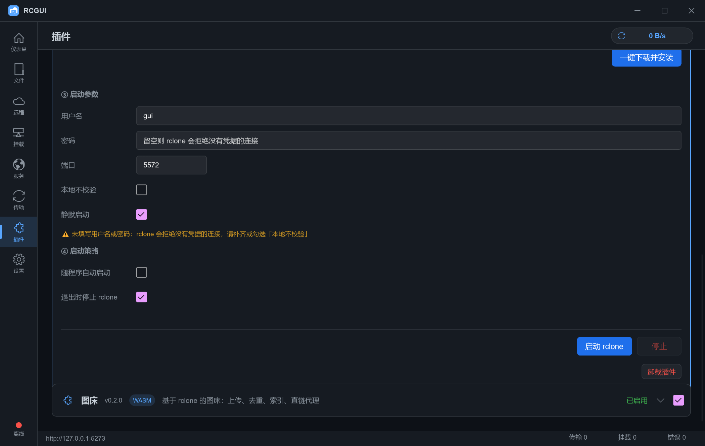

# RCGUI

[English](README.md) | 简体中文

RCGUI 是 [rclone](https://rclone.org/) 的 Windows 桌面前端，用 Rust 编写，界面基于 [Slint](https://slint.dev)。

它只做前端：RCGUI 不内嵌 rclone，不启动它，也不停止它。你自己跑 `rclone rcd`（或者让内置的「一键 rclone」插件替你拉起一个），RCGUI 通过 HTTP 连到那个 RC 端点。窗口里显示的一切都是 rclone 自身状态的投影，所以你在命令行里改动的东西，这里也会跟着变。挂载还额外需要 [WinFsp](https://winfsp.dev)，RCGUI 可以一键帮你装上。

界面内置中文与英文，运行时切换。

> RCGUI 不是旧的 *rcdeck*（用 Node + Vue 重写的 rclone Web UI）。它是从零写起的 Rust/Slint 应用，不提供任何 Web 前端——只对外提供下面列出的插件 HTTP 端点。

## 功能概览

| 页面 | 能做什么 |
| --- | --- |
| **仪表盘** | 连接状态与当前实际在用的 RC 端点，远程 / 挂载 / 服务 / 传输的实时计数，以及最近一次操作的记录 |
| **文件** | 双栏浏览——左边本机磁盘、右边远程——带排序菜单（名称 / 大小 / 修改时间）、多选、上传到或下载到指定目录、两栏之间拖放 |
| **远程** | 新建、编辑、删除远程（名称、后端类型、`key=value` 参数），填一张专用的 **K-Vault** 表单，维护代理列表并按远程绑定代理——每次启动都会重新套用 |
| **挂载** | 把任意远程挂到盘符，可选缓存模式与只读；盘符没出现会直接告诉你；WinFsp 可从官方源或镜像源安装——你建过的挂载会在下次连接成功后重新建起来 |
| **服务** | 用 HTTP、WebDAV、FTP、SFTP 或 DLNA 把远程暴露出去，每个服务可单独设凭据，可启停，能看到此刻在跑什么；记住过的服务在重连后会被重新拉起来 |
| **传输** | 进行中与已完成的传输，带进度、速度与合计；每个后台任务都标出类型（复制、移动、重命名、删除） |
| **插件** | 安装、启用、禁用、卸载插件，驱动插件声明式设置面板，恢复被卸载的内置插件，打开插件目录 |
| **设置** | RC 端点与凭据、主题、强调色、界面语言、内嵌 HTTP 服务端口、winget 镜像源、配置文件路径，以及 `rcgui.conf` 导入导出 |

## 内置插件

插件都在各自的仓库里；本仓库只保留锁文件 `plugins/manifest.json`，为每个插件钉住版本、资产名与 SHA-256。

| 插件 | 版本 | 作用 |
| --- | --- | --- |
| [imagehost](https://github.com/h897105167/rcgui-plugin-imagehost) | 0.6.1 | 把本机图片传到 rclone 远程并给出直链（可选短链），另提供一个供其他程序 POST 的 HTTP 上传服务 |
| [oneclick](https://github.com/h897105167/rcgui-plugin-oneclick) | 0.3.3 | 搜索、校验、下载并启动本机 rclone，在 RCGUI 打开期间让它一直跑着（仅 Windows） |



## 环境要求

| 项目 | 说明 |
| --- | --- |
| Windows 10 / 11（x64） | 目前唯一支持的目标平台 |
| [Rust](https://rustup.rs/) + MSVC 工具链 | 从源码构建需要 |
| `wasm32-wasip1` target | `rustup target add wasm32-wasip1`——插件是 WASI 模块 |
| [WinFsp](https://winfsp.dev) | 可选，只有 **挂载** 页需要，且可以在程序里直接安装 |
| 一个运行中的 `rclone rcd` | 构建时可选；运行时必需，除非让插件替你启动一个 |

## 快速开始

```powershell
git clone https://github.com/h897105167/rclone_gui_windows.git
cd rclone_gui_windows
.\scripts\build.ps1
```

`build.ps1` 会拉取锁定版本的插件包、校验其 SHA-256、构建整个 workspace，最后把可执行文件留在 `target\release\rclone-gui.exe`。

| 参数 | 作用 |
| --- | --- |
| `-Release` | 构建 release 配置（默认是 debug） |
| `-Run` | 构建成功后立刻启动程序 |
| `-SkipPlugins` | 不拉取、不刷新插件包 |
| `-ForcePlugins` | 即使缓存副本与锁文件一致也重新下载插件包 |

## 手动构建

插件包必须在 `cargo build` 之前就位，因为它们会被嵌进二进制：

```powershell
.\scripts\fetch_plugins.ps1
cargo build -p rclone-gui
```

`fetch_plugins.ps1` 读 `plugins/manifest.json`，从插件仓库下载对应 release 包，按锁文件校验 SHA-256，解包到 `crates/app/assets/plugins/`。

## 连接 rclone

RCGUI 走的是 rclone 的 RC API，所以 `rclone` 得在某个地方听着。一次典型会话：

```powershell
rclone rcd --rc-addr 127.0.0.1:5574 --rc-user gui --rc-pass <your-password>
```

然后把同样的地址与凭据填进 **设置**，点 **连接 / 握手**。如果 rclone 是用 `--rc-no-auth` 起的，就勾上「不鉴权」——否则除 `core/version` 以外每个端点都会回 403。

挂载与服务在 rclone 里本身没有持久化：`rclone mount` 与 `rclone serve` 只活到启动它的进程结束为止。所以 RCGUI 会记住你建过的那几项，在每次连接成功后通过 RC 接口重新下发一遍：已经挂在盘符上、已经在监听的服务直接跳过，单条失败只提示该条、不影响其余条目。卸载或停止某一项，就等于把它忘掉。如果 RC 端点压根没配置鉴权，这一轮重放会被跳过——连接状态里已经写明了原因。

## 内嵌 HTTP 服务

RCGUI 可以对外提供一个小的 HTTP 服务（默认端口 **5273**，在设置里改），让外部工具和插件能访问到它：

| 路由 | 用途 |
| --- | --- |
| `GET /api/health` | 程序自身的存活探测 |
| `ANY /plugin/{id}` | 转发给 id 为 `{id}` 的插件 |
| `ANY /plugin/{id}/{*rest}` | 同上，可带任意子路径 |
| `ANY /api/plugin/{id}/{*rest}` | 上面那条的旧别名，为兼容老客户端保留 |

插件在 `config.json` 里写 `"http_entry": true` 即表示愿意处理 HTTP；请求随后通过插件的 `http` 能力协商，每次调用是一轮 JSON 往返。

## 插件机制

一个插件就是一个目录：`config.json`（身份、版本、能力、入口）加一个为 `wasm32-wasip1` 编译的 `main.wasm`。宿主界面里没有插件 API：面板由 `config.json` 的 `plugin_setting.controls` **声明式**描述，宿主照着渲染，并对任何具体插件一无所知。

- **能力。** 插件必须声明、再按需申请它要用的每一项能力：`kv`、`ui`、`fs`、`http`、`proc`、`net`、`rclone`、`env`。依赖由宿主检查，每次调用都是 stdin/stdout 上的一轮 JSON 请求 / 响应。
- **多语言。** 展示字符串——标签、提示、选项名、`tags`——都可以写成 `{"zh": "…", "en": "…"}`。宿主每次调用插件都会带上当前语言（`params.lang`），落盘时存的是用户选中的值而不是显示文案。
- **生命周期。** 插件可以声明 `on_start` / `on_exit` 钩子，可以禁用，也可以卸载——内置插件卸载后会留下墓碑，可以在插件页里恢复，而不是彻底消失。
- **完整性。** 构建期的插件包在拉取时校验一次，程序解包到 `%APPDATA%\RCGUI\plugins\<id>\` 时再校验一次。

完整协议——清单结构、能力签名、动作协议——见 [`docs/PLUGIN.md`](docs/PLUGIN.md)。

## 数据目录

配置与运行时状态是分开的：

- `%APPDATA%\RCGUI\`——`config.json`（RC 端点、服务端口、界面语言、按远程绑定的代理、你要求过的挂载与服务）、profiles、插件副本与 kv 存储。
- 首次启动会把已存在的 `%APPDATA%\rclone-gui\` 整个复制过来，所以从旧名字升级不会丢设置。
- **便携模式：** 在 `rclone-gui.exe` 旁边放一个名为 `portable` 的空文件，所有内容就搬到可执行文件旁的 `data\`。

`rcgui.conf` 是用来导入导出整套档案（远程、挂载、服务）的版本化格式。默认会剥离凭据，所以导出的文件可以随便带走。

## 开发

```powershell
cargo build --workspace
cargo test --workspace
cargo run -p plugin_host --example protocol_test
```

## 项目结构

```
crates/
  app/       Slint 界面、RC 客户端接线与 HTTP 服务
  i18n/      中英文字典与 `t` / `f` 辅助函数
  profile/   版本化的 `rcgui.conf` 导入导出格式
  rc/        rclone RC API 的类型化客户端
  rclone/    遗留的进程辅助（探测 exe、托管 rcd 子进程、`cat` 流式读取）；
             RC 客户端已迁到 rc/，本 crate 计划移除
  plugin/    WASI 插件宿主、能力代理与清单处理
plugins/
  manifest.json   钉住的插件版本及其 SHA-256
scripts/     build.ps1、fetch_plugins.ps1、打包辅助
docs/        PLUGIN.md、CHANGELOG.md、验证记录
```

## 文档

| 文件 | 内容 |
| --- | --- |
| [`docs/CHANGELOG.md`](docs/CHANGELOG.md) | 所有改动，新的在前 |
| [`docs/PLUGIN.md`](docs/PLUGIN.md) | 插件清单、能力组、动作协议、HTTP 入口 |
| [`docs/proxy-verification.md`](docs/proxy-verification.md) | 每个 rclone 后端实际接受什么样的代理，实测结果 |

## 安全提示

- RC 密码以明文存在 `config.json` 里。用一对专用的 `--rc-user/--rc-pass`，并让 RC 端口只留在回环地址上。
- 插件跑在 WASI 沙箱里，只能通过声明过的能力接触系统。`fs.`、`proc.`、`http.` 是高危的那几个——信任一个插件之前先读它的 `config.json`。
- 内嵌 HTTP 服务只绑回环地址，自身没有鉴权；插件 `http_entry` 暴露出来的东西，本机任何进程都能访问。
- `rclone obscure` 只是混淆配置里的值，不是加密：`rclone.conf` 里被 obscure 过的密码是可以还原的。
